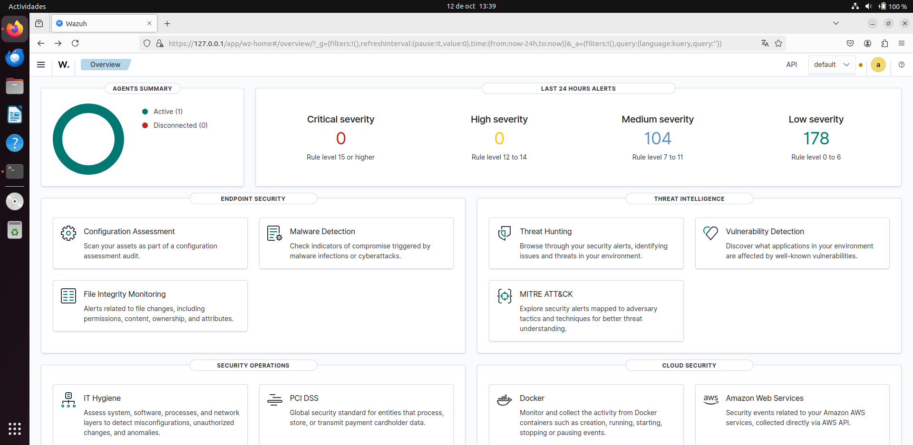
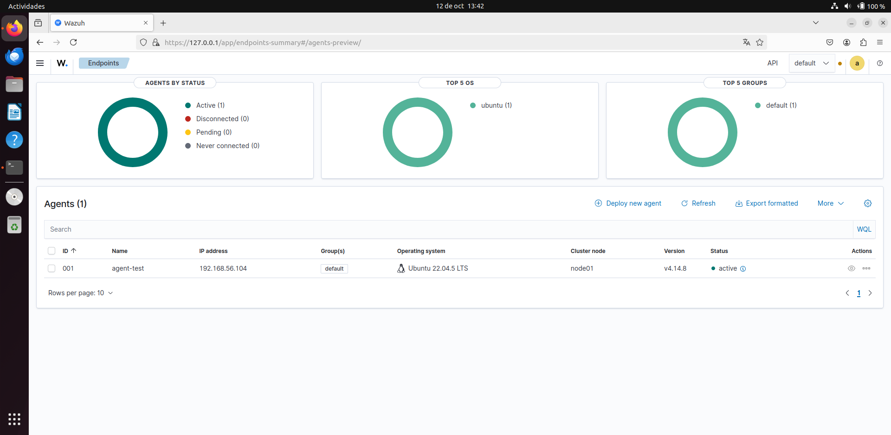
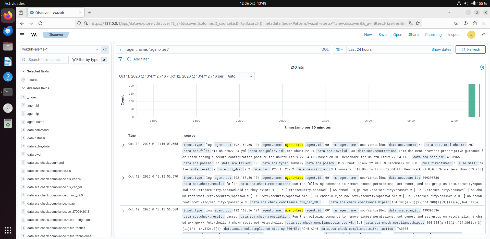

# Wazuh + TPOT SOC Lab


Laboratorio SOC personal para practicar operativa Blue Team: despliegue de un
SIEM (Wazuh) en local y un honeypot multi-servicio (TPOT) en una VPS pública,
conectados por túnel Tailscale. Los ataques reales contra el honeypot se
detectan, enriquecen y visualizan en tiempo real.

> **Estado:** Fase 1 completada . Fase 2 en progreso - Wazuh operativo y T-Pot desplegado en la VPS

## Fases del proyecto

| Fase | Descripción | Estado |
|---|---|---|
| **1. Wazuh base** | SIEM desplegado en local + agente validado | ✅ Completada |
| **2. Honeypot** | T-Pot en VPS pública + túnel Tailscale | 🚧 En progreso |
| **3. Detección** | Reglas custom + mapeo MITRE ATT&CK | ⏳ Pendiente |
| **4. Visualización** | Dashboards + Active Response | ⏳ Pendiente |

---

## 1. Problema

Los perfiles junior en ciberseguridad suelen tener dificultades para demostrar
experiencia práctica real. Los cursos y certificaciones no siempre evidencian
capacidad operativa: montar, monitorizar y analizar eventos en un SIEM real.

Este proyecto documenta la construcción de un SOC funcional end-to-end con
evidencia reproducible: instalación, configuración, reglas de detección,
dashboards y análisis de ataques reales capturados por un honeypot expuesto
en Internet.

---

## 2. Objetivo

**Qué hace este proyecto:**

- Despliega Wazuh todo-en-uno (Manager + Indexer + Dashboard) sobre Ubuntu 22.04 LTS.
- Expone un honeypot T-Pot (multi-servicio) en una VPS pública para recibir ataques reales de Internet.
- Conecta ambos entornos mediante túnel Tailscale P2P, sin exponer el SIEM.
- Aplica reglas de detección mapeadas a MITRE ATT&CK.
- Visualiza la actividad maliciosa en dashboards específicos.

**Qué NO hace:**

- No es un SOC de producción.
- No sustituye a un SIEM empresarial.
- No pretende detectar amenazas avanzadas (APTs).

---

## 3. Arquitectura

### Estado actual (Fase 2 en progreso)

```
┌───────────────────────────────────────┐         ┌───────────────────────────────────────┐
│  VPS pública (Contabo)                │         │  Lab local (VirtualBox)               │
│  Ubuntu 26.04 LTS · 4 vCPU · 8 GB RAM │         │  Ubuntu 22.04 LTS · 8 vCPU · 8 GB RAM │
│                                       │         │                                       │
│  ┌─────────────────────────────────┐  │         │  ┌─────────────────────────────────┐  │
│  │  T-Pot (23 contenedores)        │  │         │  │  Wazuh Manager                  │  │
│  │                                 │  │         │  │  Wazuh Indexer                  │  │
│  │  - Cowrie (SSH/Telnet)          │  │         │  │  Wazuh Dashboard                │  │
│  │  - Dionaea (SMB/FTP/MSSQL)      │  │Tailscale│  │                                 │  │
│  │  - Suricata (IDS)               │◄─┼───P2P───┼─►│  Puertos expuestos:             │  │
│  │  - Conpot (SCADA/ICS)           │  │cifrado  │  │   · 1514  (agentes)             │  │
│  │  - Dicompot, Medpot, ...        │  │         │  │   · 1515  (registro)            │  │
│  │                                 │  │         │  │   · 55000 (API)                 │  │
│  │  IP Tailscale: 100.112.220.3    │  │         │  │   · 443   (dashboard)           │  │
│  └─────────────────────────────────┘  │         │  └─────────────────────────────────┘  │
│                                       │         │                                       │
│  SSH admin: puerto 64295              │         │  IP Tailscale: 100.108.83.63          │
└───────────────────────────────────────┘         └───────────────────────────────────────┘
                     ▲
                     │  Ataques reales de Internet
                     │  (bots, escáneres, atacantes)

```

El túnel Tailscale permite al agente Wazuh de la VPS enviar elementos al manager local sin exponer los puertos del SIEM a Internet.

- **Fase 3:** Reglas de detección custom + mapeo MITRE ATT&CK
- **Fase 4:** Dashboards personalizados + Active Response + enriquecimiento 
---

## 4. Instalación

Documentación detallada paso a paso en
[`docs/01-installation.md`](docs/01-installation.md).

**Resumen rápido:**

```bash
# 1. Ajuste del kernel (crítico para Wazuh Indexer)
sudo sysctl -w vm.max_map_count=262144
echo "vm.max_map_count=262144" | sudo tee -a /etc/sysctl.conf
sudo sysctl -p

# 2. Descarga del instalador
cd ~
curl -sO https://packages.wazuh.com/4.9/wazuh-install.sh
curl -sO https://packages.wazuh.com/4.9/config.yml
chmod +x wazuh-install.sh

# 3. Ajuste de config.yml (sustituir placeholders)
sed -i 's/<indexer-node-ip>/127.0.0.1/g' config.yml
sed -i 's/<wazuh-manager-ip>/127.0.0.1/g' config.yml
sed -i 's/<dashboard-node-ip>/127.0.0.1/g' config.yml

# 4. Instalación all-in-one
sudo bash wazuh-install.sh -a
soc@soc-VirtualBox:~/wazuh-tpot-soc$ echo "=== Git status ==="
git status --short

echo ""
echo "=== ¿Qué dice el README de docs? ==="
grep -A 8 "## 10. Documentación adicional" README.md

echo ""
echo "=== Fases del proyecto en README ==="
grep -A 8 "## Fases del proyecto" README.md
=== Git status ===
M  .gitignore
A  docs/06-vps-setup.md
A  docs/adr/0002-tailscale-sobre-wireguard.md

=== ¿Qué dice el README de docs? ===
## 10. Documentación adicional

- [Instalación detallada](docs/01-installation.md)
- [Arquitectura](docs/02-architecture.md)
- [Validación del agente](docs/03-agent-validation.md)
- [Incidentes documentados](docs/04-incidents.md)
- [Troubleshooting](docs/05-troubleshooting.md)
- [Decisiones de diseño (ADR)](docs/adr/)
---

=== Fases del proyecto en README ===
## Fases del proyecto

| Fase | Descripción | Estado |
|---|---|---|
| **1. Wazuh base** | SIEM desplegado en local + agente validado | ✅ Completada |
| **2. Honeypot** | TPOT en VPS pública + túnel Tailscale | 🚧 En progreso |
| **3. Detección** | Reglas custom + mapeo MITRE ATT&CK | ⏳ Pendiente |
| **4. Visualización** | Dashboards + Active Response | ⏳ Pendiente |

soc@soc-VirtualBox:~/wazuh-tpot-soc$ 
```

Duración estimada: 10-20 minutos.

---

## 5. Uso

Acceso al dashboard desde el navegador de la VM:

```
https://127.0.0.1
```

Credenciales generadas por el instalador y almacenadas en
`~/wazuh-install-files.tar`.

Verificación rápida del estado:

```bash- [Instalación de T-Pot](docs/07-tpot-installation.md)
# Servicios activos
sudo systemctl is-active wazuh-indexer wazuh-manager wazuh-dashboard

# Estado del cluster
curl -sk -u admin:TU_PASSWORD https://localhost:9200/_cluster/health?pretty
```

---

## 6. Capturas

## 6. Capturas

### Wazuh Dashboard — Overview con agente activo



*Panel principal del Wazuh Dashboard mostrando 1 agente activo.*

### Agents — Agente conectado



*El agente `agent-test` en estado Active en la vista de Agents.*

### Security Events — Eventos del agente



*Discover filtrado por `agent.name: agent-test` mostrando 216 eventos capturados.*

---

## 7. Testing

Pendiente de implementar cuando se añadan las reglas de detección.

Los tests previstos validarán que las reglas personalizadas disparan con
eventos de ejemplo (logs sintéticos de Cowrie, Dionaea y Suricata).

---

## 8. Seguridad

### Gestión de secretos

Este repositorio **no contiene credenciales reales**. Patrón seguido:

- `.env.example` → plantilla pública con valores `CHANGE_ME`
- `.env` → fichero local con valores reales, ignorado por git

El `.gitignore` bloquea explícitamente:

- Ficheros `.env` y variantes
- Claves y certificados (`*.pem`, `*.key`, `*.crt`)
- Claves Tailscale (`privatekey`, `publickey`)
- Credenciales del instalador (`wazuh-passwords.txt`, `wazuh-install-files.tar`)

### Superficie de exposición

- El dashboard **no se expone directamente a Internet**.
- El acceso se realiza desde la red local o por túnel Tailscale.
- La VPS solo expone los puertos de los honeypots (deliberadamente vulnerable).

### Aviso legal

Este proyecto se usa exclusivamente contra infraestructura propia.
Nunca ataques sistemas de terceros sin autorización por escrito.

---

## 9. Roadmap

### Fase 1 — Wazuh base
- [x] Desplegar Wazuh todo-en-uno en Ubuntu 22.04
- [x] Verificar cluster `green` y acceso al dashboard
- [x] Conectar agente Wazuh local para validar pipeline

### Fase 2 — Honeypot en VPS
- [x] Contratar VPS (Contabo) y preparar el sistema
- [x] Configurar túnel Tailscale VPS ↔ manager local
- [x] Verificar conectividad y puertos Wazuh a través del túnel
- [x] Instalar T-Pot (perfil mini) en la VPS
- [x] Verificar arranque de los contenedores de honeypots
- [ ] Instalar agente Wazuh en la VPS
- [ ] Configurar `localfiles` para los logs de T-Pot
- [ ] Verificar llegada de eventos reales al dashboard

### Fase 3 — Detección
- [ ] Añadir reglas de detección para Cowrie
- [ ] Añadir reglas de detección para Dionaea
- [ ] Añadir reglas de detección para Suricata
- [ ] Documentar cada regla con mapeo MITRE ATT&CK
- [ ] Añadir tests de reglas con eventos de ejemplo

### Fase 4 — Visualización y respuesta
- [ ] Exportar dashboards personalizados como código (ndjson)
- [ ] Añadir Active Response para bloqueo de IPs
- [ ] Integrar enriquecimiento (VirusTotal, AbuseIPDB, OTX)

---

## 10. Documentación adicional

- [Instalación detallada](docs/01-installation.md)
- [Arquitectura](docs/02-architecture.md)
- [Validación del agente](docs/03-agent-validation.md)
- [Incidentes documentados](docs/04-incidents.md)
- [Troubleshooting](docs/05-troubleshooting.md)
- [Configuración de la VPS](docs/06-vps-setup.md)
- [Instalación de T-Pot](docs/07-tpot-installation.md)
- [Decisiones de diseño (ADR)](docs/adr/)
---

## 11. Incidencias documentadas

Durante la construcción del laboratorio han aparecido problemas reales
documentados en [`docs/04-incidents.md`](docs/04-incidents.md):

### Fase 1 — Wazuh base

1. `wazuh-agent` destruye `wazuh-manager` en el mismo host
2. Dashboard roto tras reinstall del manager (403 + `version_conflict`)
3. Manager no arranca por timeout de systemd
4. Locks huérfanos en `/var/ossec/var/run/` tras timeout
5. Indexer no arranca por timeout de systemd (mismo patrón)

### Fase 2 — VPS + Tailscale

6. DNS roto tras cambiar adaptador de red en VirtualBox
7. Tailscale: autenticación por URL no sincroniza
8. Sesión de Tailscale caduca entre sesiones SSH
9. T-Pot rechaza Ubuntu 24.04 — requiere 26.04
10. T-Pot no se puede instalar desde root
11. Manager sin clave SSH — no se puede autenticar por clave

## Licencia

MIT — ver [LICENSE](LICENSE).
