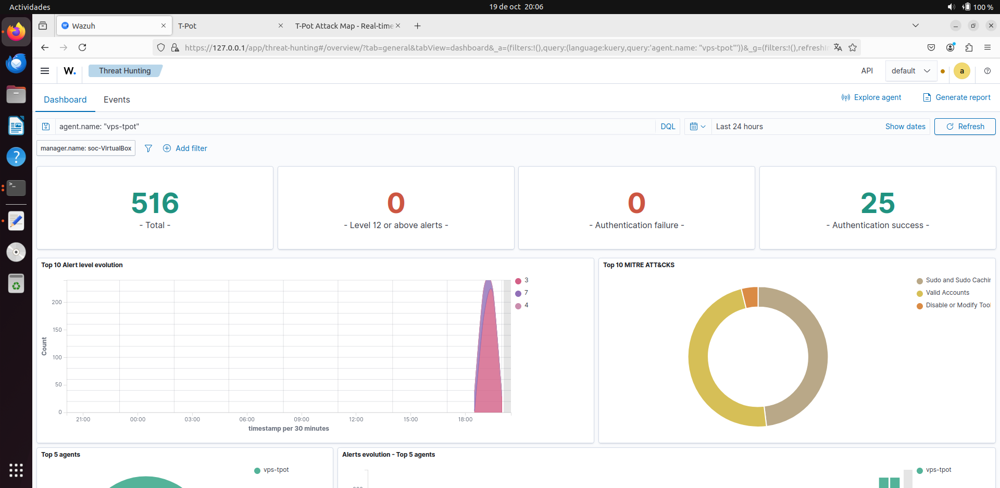
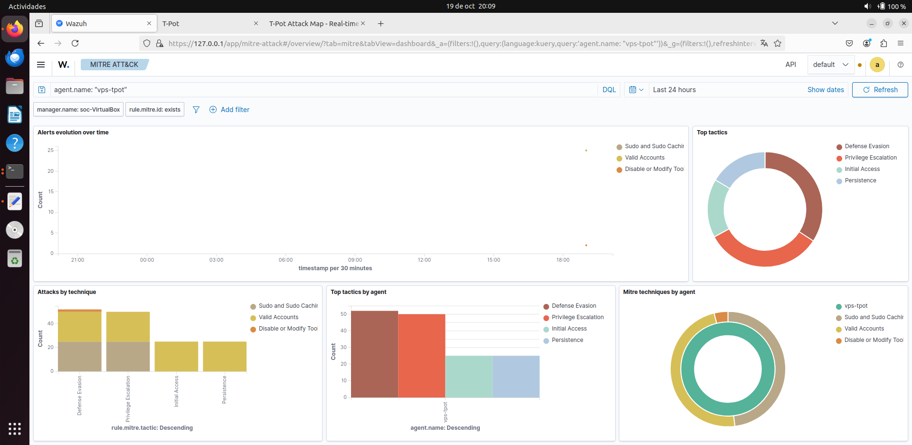
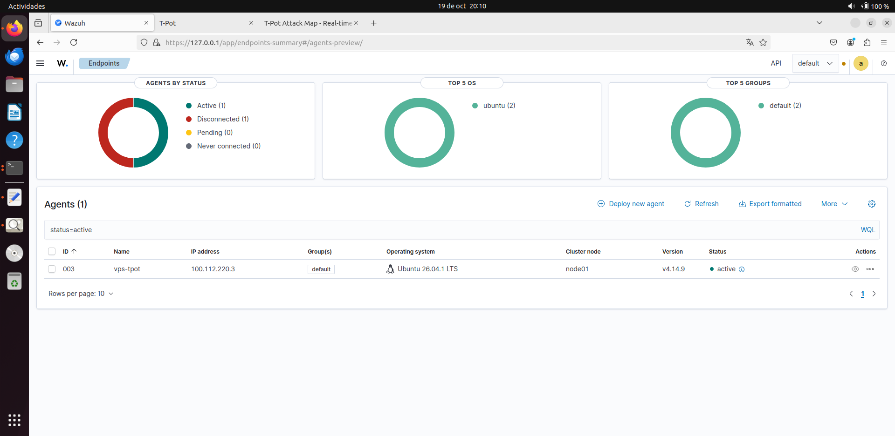

# Integración del agente Wazuh en la VPS

Documentación del despliegue del agente Wazuh en la VPS de Contabo (donde corre T-Pot) y su conexión con el manager local a través del túnel Tailscale.

## Contexto

- **Manager Wazuh:** VM local (`soc-VirtualBox`), IP Tailscale `100.108.83.63`.
- **Agente Wazuh:** VPS Contabo (`vmi3664658`), IP Tailscale `100.112.220.3`.
- **Honeypots:** T-Pot (23 contenedores activos), logs en `/home/tadmin/tpotce/data/`.
- **Túnel:** Tailscale P2P directo (sin relay DERP).

## Requisitos

- La VPS debe tener Tailscale instalado y conectado al mismo tailnet que el manager.
- El manager debe tener los puertos 1514 y 1515 accesibles desde el tailnet.
- La VPS debe tener al menos 512 MB de RAM para el agente (T-Pot ya consume 6-7 GB).

## Proceso de instalación

### 1. Registrar el agente en el manager

En el manager:

```bash
sudo /var/ossec/bin/manage_agents
```

```
A → Name: vps-tpot → IP: 100.112.220.3 → y
E → ID: 003 → COPIAR CLAVE
Q
```

> **Nota:** el agente debe registrarse con su IP Tailscale (`100.112.220.3`), no con su IP pública.

### 2. Instalar el agente en la VPS

En la VPS:

```bash
curl -s https://packages.wazuh.com/key/GPG-KEY-WAZUH | \
  sudo gpg --dearmor -o /usr/share/keyrings/wazuh.gpg

echo "deb [signed-by=/usr/share/keyrings/wazuh.gpg] https://packages.wazuh.com/4.x/apt/ stable main" | \
  sudo tee /etc/apt/sources.list.d/wazuh.list

sudo apt update

sudo WAZUH_MANAGER='100.108.83.63' \
     WAZUH_AGENT_NAME='vps-tpot' \
     apt install -y wazuh-agent
```

### 3. Importar la clave

```bash
sudo /var/ossec/bin/manage_agents -i <CLAVE_COPIADA>
# Confirmar con "y"
```

### 4. Configurar `localfiles` para T-Pot

T-Pot escribe los logs en `/home/tadmin/tpotce/data/`. El agente debe leer esos ficheros y enviarlos al manager.

Editar `/var/ossec/etc/ossec.conf` y añadir antes de `</ossec_config>`:

```xml
<!-- T-Pot: Dionaea (SMB/FTP/MSSQL honeypot) -->
<localfile>
  <log_format>json</log_format>
  <location>/home/tadmin/tpotce/data/dionaea/log/dionaea.json</location>
</localfile>

<!-- T-Pot: Suricata (IDS) -->
<localfile>
  <log_format>json</log_format>
  <location>/home/tadmin/tpotce/data/suricata/log/eve.json</location>
</localfile>

<!-- T-Pot: Honeypots varios (SSH, HTTP, RDP, SIP...) -->
<localfile>
  <log_format>syslog</log_format>
  <location>/home/tadmin/tpotce/data/honeypots/log/ssh.log</location>
</localfile>
<localfile>
  <log_format>syslog</log_format>
  <location>/home/tadmin/tpotce/data/honeypots/log/http.log</location>
</localfile>
<localfile>
  <log_format>syslog</log_format>
  <location>/home/tadmin/tpotce/data/honeypots/log/rdp.log</location>
</localfile>
<localfile>
  <log_format>syslog</log_format>
  <location>/home/tadmin/tpotce/data/honeypots/log/sip.log</location>
</localfile>
```

> **Nota sobre Cowrie:** la versión actual de T-Pot no despliega Cowrie como contenedor independiente. Los honeypots SSH se gestionan dentro del contenedor `honeypots` (y escriben en `ssh.log`, no en `cowrie.json`). No intentar leer `cowrie.json` o dará error `No such file or directory`.

### 5. Arrancar el agente

```bash
sudo systemctl daemon-reload
sudo systemctl enable wazuh-agent
sudo systemctl start wazuh-agent
sudo systemctl status wazuh-agent
```

### 6. Verificar en el manager

```bash
sudo /var/ossec/bin/agent_control -l
```

Esperado:

```
ID: 000, Name: soc-VirtualBox (server), IP: 127.0.0.1, Active/Local
ID: 003, Name: vps-tpot, IP: 100.112.220.3, Active
```

## Evidencia

### Eventos de T-Pot en el dashboard



*Discover filtrado por `agent.name: vps-tpot` mostrando eventos reales de Suricata y honeypots.*

### MITRE ATT&CK con técnicas detectadas



*Técnicas mapeadas por las reglas de Wazuh aplicadas a los eventos de T-Pot.*

### Agente activo en el manager



*El agente `vps-tpot` en estado Active con su IP Tailscale.*

## Problemas encontrados

Durante la integración aparecieron varios problemas, todos documentados con
detalle en [`04-incidents.md`](04-incidents.md):

- [Incidente 12: Agente en bucle "Never connected" por auto-enrollment](04-incidents.md#incidente-12-agente-wazuh-en-bucle-never-connected-por-auto-enrollment)
- [Incidente 13: Error de `cowrie.json` — T-Pot no usa Cowrie en esta versión](04-incidents.md#incidente-13-error-de-cowriejson--t-pot-no-usa-cowrie-en-esta-versión)
- [Incidente 14: Mismatch de versión agente (4.14.9) vs manager (4.14.8)](04-incidents.md#incidente-14-mismatch-de-versión-agente-4149-vs-manager-4148)

## Verificación del pipeline

```bash
# En la VPS: verificar que el agente lee los logs
sudo tail -20 /var/ossec/logs/ossec.log | grep "Analyzing file"

# En el manager: verificar que llegan eventos
sudo grep "vps-tpot" /var/ossec/logs/alerts/alerts.log | tail -5

# En el dashboard: filtrar por agent.name: vps-tpot
```

## Resultado

El pipeline funciona correctamente:

- Internet → T-Pot (VPS) → wazuh-agent → Tailscale → Wazuh Manager → Indexer → Dashboard.
- Los eventos de Suricata, Dionaea y honeypots (SSH/HTTP/RDP/SIP) llegan al manager.
- Las reglas de Wazuh (por defecto) procesan los eventos.
- El dashboard muestra la actividad maliciosa en tiempo real.

## Próximos pasos

1. Crear reglas de detección custom para:
   - Fuerza bruta SSH (múltiples intentos desde misma IP)
   - Comandos sospechosos ejecutados en honeypots
   - Descargas de malware detectadas
2. Añadir dashboards personalizados para T-Pot
3. Configurar Active Response para bloquear IPs atacantes
