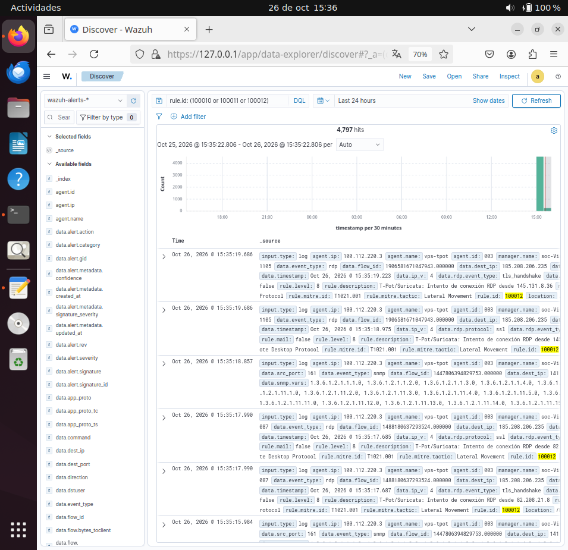

# Reglas de detección custom

Reglas de detección desarrolladas durante la **Fase 3** del laboratorio para
procesar la telemetría capturada por T-Pot en la VPS y mapearla a MITRE
ATT&CK.

## Contexto

El pipeline completo de la Fase 2 (T-Pot → wazuh-agent → manager → dashboard)
genera miles de eventos diarios. Las reglas por defecto de Wazuh procesan los
eventos genéricos, pero para detectar patrones específicos de ataque
necesitamos reglas custom.

Estas reglas se ubican en `/var/ossec/etc/rules/local_rules.xml` del manager
y se cargan automáticamente al reiniciar el servicio.

## Reglas implementadas

### 1. SNMP scan desde IP externa (100010)

| Campo | Valor |
|---|---|
| **MITRE** | T1046 — Network Service Discovery |
| **Táctica** | Discovery |
| **Nivel** | 7 (Medium) |
| **Fuente** | Suricata (`eve.json`) |
| **Condición** | `event_type = snmp` y `snmp.community = public` |

**Lógica:** detecta intentos de descubrimiento de servicios SNMP usando la
community por defecto `public`, que es un indicador de reconocimiento
automatizado (nmap, masscan, etc.).

### 2. User-Agent sospechoso en HTTP (100011)

| Campo | Valor |
|---|---|
| **MITRE** | T1595 — Active Scanning |
| **Táctica** | Reconnaissance |
| **Nivel** | 5 (Low) |
| **Fuente** | Suricata (`eve.json`) |
| **Condición** | `event_type = http` y User-Agent contiene `Infrawatch`, `zgrab`, `masscan`, `nmap`, `sqlmap` |

**Lógica:** identifica bots de reconocimiento masivo por su User-Agent.

### 3. Conexión RDP desde IP externa (100012)

| Campo | Valor |
|---|---|
| **MITRE** | T1021.001 — Remote Services: RDP |
| **Táctica** | Lateral Movement |
| **Nivel** | 8 (High) |
| **Fuente** | Suricata (`eve.json`) |
| **Condición** | `event_type = rdp` y `dest_port = 3389` |

**Lógica:** cualquier intento de conexión RDP a la VPS pública es
sospechoso, ya que la VPS no tiene servicios RDP legítimos.

## Fichero de configuración

Las reglas se definen en `/var/ossec/etc/rules/local_rules.xml`:

```xml
<group name="tpot,custom,suricata,">
  <rule id="100010" level="7">
    <if_sid>86600</if_sid>
    <field name="event_type">snmp</field>
    <field name="snmp.community">public</field>
    <description>T-Pot/Suricata: SNMP scan desde $(data.src_ip) con community public</description>
    <mitre>
      <id>T1046</id>
    </mitre>
  </rule>

  <rule id="100011" level="5">
    <if_sid>86600</if_sid>
    <field name="event_type">http</field>
    <regex type="pcre2">Infrawatch|zgrab|masscan|nmap|sqlmap</regex>
    <description>T-Pot/Suricata: User-Agent sospechoso desde $(data.src_ip)</description>
    <mitre>
      <id>T1595</id>
    </mitre>
  </rule>

  <rule id="100012" level="8">
    <if_sid>86600</if_sid>
    <field name="event_type">rdp</field>
    <field name="dest_port">3389</field>
    <description>T-Pot/Suricata: Intento de conexión RDP desde $(data.src_ip)</description>
    <mitre>
      <id>T1021.001</id>
    </mitre>
  </rule>
</group>
```

## Método de validación

Para probar una regla sin esperar a que ocurra un ataque real:

```bash
sudo /var/ossec/bin/wazuh-logtest
```

Y pegar un evento JSON de ejemplo (como los logs que llegan de T-Pot).

El output muestra qué regla se dispara, su nivel y su mapeo MITRE.

## Troubleshooting

### Las reglas no disparan

1. **Verificar que el manager las ha cargado:**
   ```bash
   sudo grep "Total rules enabled" /var/ossec/logs/ossec.log | tail -1
   ```
   El número debe ser 8451 + N (reglas añadidas).

2. **Probar con `wazuh-logtest`:** si dispara con el JSON de prueba,
   funciona. Si no, hay un problema con los campos.

3. **Usar `<if_sid>`:** para reglas que operan sobre un decoder específico
   (Suricata, JSON, etc.), hay que añadir `<if_sid>` con el ID de la regla
   base que ya consume el evento.

### Error: "Field 'X' is static"

Si el manager no arranca con el error `Field 'X' is static`, significa que
`X` es un campo reservado de Wazuh. Soluciones:

- Usar `data.X` si el campo está dentro del JSON.
- Cambiar el nombre del campo.

Ejemplo: `protocol` es reservado, `data.protocol` no lo es.

## Capturas de las detecciones en el dashboard



*Discover filtrado por las reglas custom (100010, 100011, 100012) mostrando
**4.797 hits** en 24 horas. En los eventos se puede observar el mapeo a
MITRE ATT&CK: `T1021.001` (Lateral Movement) para las conexiones RDP y
`T1046` (Discovery) para los escaneos SNMP. Los atacantes provienen de
múltiples IPs reales de Internet.*

## Referencias

- [Wazuh — Rules syntax](https://documentation.wazuh.com/current/user-manual/ruleset/ruleset-xml-syntax/rules.html)
- [MITRE ATT&CK](https://attack.mitre.org/)
- [Incidentes documentados](04-incidents.md)
- [Troubleshooting](05-troubleshooting.md)
- [Agente Wazuh en la VPS](08-wazuh-agent-vps.md)
